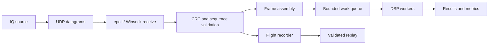

# SignalFlight Systems Edition：架构与线程模型

## 数据流

`sf_source` → UDP datagram → Linux epoll / Winsock select → CRC与字段校验 → SeqTracker → FrameAssembler → `BoundedQueue<FrameTask>` → N个C++工作线程 → DSP/结果文件。

`FlightRecorder`接收网络入站原始包和事件；它有独立后台**进程内写盘线程**，`Engine::close()`等待该线程完成。在命令行演示和测试中整个服务始终以前台进程运行；这里的写盘线程不是nohup后台运行。

### 线程责任与锁

- 网络接收线程/测试注入线程通过`ingress_mu_`序列化修改序号窗口、帧重组和压力状态机。
- 工作线程通过`BoundedQueue`内部互斥锁和`condition_variable`获得任务；`stop()`唤醒消费者，保证**排空队列**再退出。
- DSP计算不持有队列锁；写结果文件时只持有`results_mu_`以避免多线程输出混写。
- 录制器的环形缓冲与快照队列在`mu_`下修改，异步写盘在线程外完成；`finish_once_`保证多个并发调用不会跳过`join()`。

### 过载和损失

根据队列水位进入Normal/Degraded/Critical，轻量模式仅计算均方功率，Critical时执行有界丢弃。UDP不能向无流控发送方施加真实传输背压；因此CPU高负载下有意丢弃必须统计为`queue_dropped`。无丢失承诺仅在具体测试速率和硬件配置下成立。

### 平台差异

- Linux使用非阻塞Socket+epoll，`--batch`时调用`recvmmsg`。
- Windows使用Winsock2+select；`--batch`仅表示每次就绪后有界循环接收，不表示Windows支持`recvmmsg`。
- 网络资源使用RAII封装；Windows宽字符命令行和UTF-8/UTF-16路径转换可正确处理中文路径。

### 回放能力边界

`sf_replay`先完整验证SFR0002页尾记录数和摘要，再以相同输入顺序、逻辑时间将数据送入单线程参考处理。它能复现协议、乱序、缺包、处理算法行为；不能精确复现多线程竞争、调度顺序和真实操作系统网络队列。对后者应使用可控同步测试与压力注入验证。
